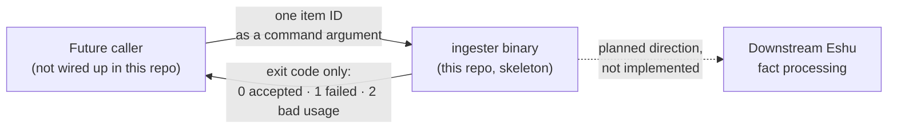

# eshu-ingester: early skeleton, not a running service

Status: pre-release skeleton. This repo is the future home of Eshu's
intake step, the bit that accepts incoming items and groups them into
batches. Today it holds a small batching library and a one-shot command
that accepts a single item ID and exits. Nothing here listens on a port,
reads a queue, or stores anything, and no production Eshu system sends
work to it. Please read this README as "what the seed code proves", not
as a service you can point traffic at.

In one line: `internal/intake` validates items and groups them by count
or age, and `cmd/ingester` admits exactly one item per run and reports
the result as its exit code.



Today the only interface is "run the binary with one item ID, read the
exit code". The dashed arrow is why the repo exists. It isn't behaviour
you can use yet, and nothing in this tree runs the binary on a schedule
or from another service.

## When it fits, and when it doesn't

Use it now only if you're developing or testing the intake seed itself,
say to work on the batcher rules or the repo's CI gates.

Don't deploy it expecting a service. There's no server, no health
endpoint, no input stream, and no persistence. A container run does
exactly what a local run does: accept or reject one ID, then exit.

## Shortest path in

You'll need Go 1.26.10 (the `go` line in [go.mod](go.mod)). The module
has no third-party dependencies. Build the binary first, because
`go run` would mask the exit codes and those are the whole point:

```sh
go build -o /tmp/ingester ./cmd/ingester
/tmp/ingester my-item-1   # accepted: exit code 0
echo $?
/tmp/ingester             # bad usage: exit code 2
```

[Concepts](docs/concepts/README.md) explains the batching rules and
the exact one-shot contract. [Run it](docs/guides/run-it.md) covers
the container run and what CI checks.

## Documentation

| Doc | What's in it |
| --- | --- |
| [Docs index](docs/README.md) | Every docs section, grouped — skeleton status up front |
| [Getting started](docs/getting-started/README.md) | Build the binary and run it once |
| [Guides](docs/guides/README.md) | Run it locally or in a container; work on the batcher |
| [Concepts](docs/concepts/README.md) | The batching rules, the one-shot exit-code contract, and where the code stops today |
| [Reference](docs/reference/README.md) | Exit codes, library errors, and the (short) config surface |
| [Diagrams](docs/diagrams/README.md) | Every diagram, each with a plain-text version |
| [CI notes](docs/ci) | Dated notes on how each CI gate in this repo was set up and proved |
| [Contributing](CONTRIBUTING.md) | Local gates, CI lanes, the coverage-floor rule, and the upstream tracking issues |

## Related repos

Eshu core (`eshu-hq/eshu`) is where fact processing lives today, and
where this component's tracking issues live. Nothing calls this repo yet
and it calls nothing back: [go.mod](go.mod) declares no requirements at
all, and the code uses only the Go standard library.

## Development

Run `make ci` before you push. It covers vet, lint, format, a tidy diff,
the 500-line file cap, the tests, and the race suite with its coverage
floor. For a quick focused run, `go test ./... -count=1` is enough.

## Contributing, security, and licence

See [CONTRIBUTING.md](CONTRIBUTING.md). There's no `LICENSE`,
`SECURITY.md`, or `AGENTS.md` in this tree. Source files carry an MIT
SPDX header (look at [cmd/ingester/main.go](cmd/ingester/main.go)), but
there's no standalone licence file to point at.
