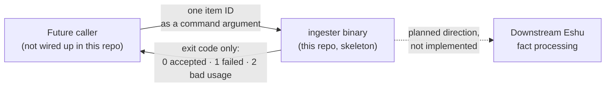

# eshu-ingester — early skeleton, not a running service

**Status: pre-release skeleton.** This repo is the future home of
Eshu's intake step (accepting incoming items and grouping them into
batches). Today it contains a small batching library and a one-shot
command that accepts a single item ID and exits. Nothing here listens
on a port, reads a queue, or stores anything, and no production Eshu
system sends work to it. Read this README as "what the seed code
proves," not as a service you can point traffic at.

In one line: a batching seed — `internal/intake` validates items and
groups them by count or age, and `cmd/ingester` admits exactly one
item per run and reports the result as its exit code.

## What this is and why it exists

Eshu turns source data into facts. Before facts can be processed,
something has to accept incoming items and hand them on in sane
groups. That accepting-and-grouping step is *intake*, and this repo
was created to hold it as its own component instead of inside Eshu
core (tracked upstream in the Eshu repo; see
[CONTRIBUTING.md](CONTRIBUTING.md) for the issue references).

What exists so far is the smallest honest version of that step: item
validation and an in-memory batcher, with tests and CI gates around
them. The long-running intake behavior — reading real input over
time — is explicitly later work; the package comment in
[cmd/ingester/main.go](cmd/ingester/main.go) says so in those words.

## Where it fits



In words: today the only interface is "run the binary with one item
ID, read the exit code." The dashed arrow is the reason the repo
exists, not behavior you can use. Nothing in this tree invokes the
binary on a schedule or from another service.

## When to use it, and when not to

Use it now only to develop or test the intake seed itself — for
example, to work on the batcher rules or the repo's CI gates.

Do not deploy it expecting a service. There is no server, no health
endpoint, no input stream, and no persistence. A container run does
exactly what a local run does: accept or reject one ID, then exit.

## Quickstart

Requires Go 1.26.10 (the `go` line in [go.mod](go.mod); the module
has no third-party dependencies).

Build the binary first — `go run` would mask the exit codes that
are the whole point:

```sh
go build -o /tmp/ingester ./cmd/ingester
/tmp/ingester my-item-1   # accepted: exit code 0
echo $?
/tmp/ingester             # bad usage: exit code 2
```

Or with the container image, which runs the same binary:

```sh
docker build -t eshu-ingester:local .
docker run --rm eshu-ingester:local my-item-1   # exit 0
docker run --rm eshu-ingester:local             # exit 2 (usage)
```

These exit codes are the whole contract today; the image behavior
was recorded in [docs/ci/supply-chain-6.md](docs/ci/supply-chain-6.md).

## The contract, exactly as the code defines it

From [cmd/ingester/main.go](cmd/ingester/main.go) (`run`):

| Input | Result |
| --- | --- |
| Exactly one non-empty argument (the item ID) | The item is added to a fresh one-item batch; exit `0` |
| Zero arguments, an empty argument, or more than one argument | Exit `2` (usage error) |
| The batch cannot be created, or the item cannot be added | Exit `1` (intake failure) |

There are no flags, no environment variables, and no stdin/stdout
protocol: the binary prints nothing. The item body is currently the
fixed placeholder bytes `{}` — the argument is an ID only, and no
payload is read from anywhere. Nothing is written to disk or sent
anywhere; the batch exists only in memory for the life of the
process, which ends immediately.

## How it works

Two pieces, both small:

- **[internal/intake](internal/intake/intake.go)** — the reusable
  part. An `Item` is an ID plus an opaque body; `Validate` rejects an
  empty ID (`ErrEmptyID`) or empty body (`ErrEmptyBody`). A `Batcher`
  holds validated items until the batch is *due to flush* — full
  (reached its item limit) or aged out (oldest item older than its
  age limit) — then `Drain` returns the items in arrival order and
  resets. Bad limits are rejected up front (`ErrInvalidConfig`), and
  adding to a full batch fails (`ErrBatchFull`). The clock is
  injected so tests are deterministic, and a `Batcher` is documented
  as not safe for concurrent use.
- **[cmd/ingester](cmd/ingester/main.go)** — a thin wrapper. It
  builds a batcher with a limit of 1 item and a one-hour age limit,
  adds the single argument as an item, and maps the outcome to the
  exit code. The batch constructor is injectable so tests cover
  every failure branch without I/O.

Because the limit is 1, the age limit and flush logic are exercised
by the library tests, not by the command. Wiring the batcher to a
real input source is the future work this skeleton is shaped for.

## Configuration

None. The binary accepts no flags and reads no environment
variables, config files, or standard input. The batch limits (1 item,
one hour) are constants in `defaultBatch` in
[cmd/ingester/main.go](cmd/ingester/main.go). (The
`INGESTER_TEST_*` variables exist only inside the test suite.)

## Deploy / run

Do not deploy this as a service — it is not one. The
[Dockerfile](Dockerfile) builds a static binary into a distroless
image whose entrypoint is that binary, so `docker run` behaves
exactly like the local run above and then exits. There is no port,
no health check, and nothing to keep running. Treat the image as
build-and-exit-code proof for CI, not as a deployable workload.

## Eshu dependencies

| Direction | Dependency | Notes |
| --- | --- | --- |
| This repo → Eshu core | None | [go.mod](go.mod) declares no requirements at all; the code uses only the Go standard library and imports no other Eshu repo. |
| Eshu parts → this repo | None today | No caller is wired up in this tree. A future caller would run the binary (or its successor) and act on the exit code. |
| Intended place in Eshu | Intake, before fact processing | Direction only, per the repo's stated purpose in [CONTRIBUTING.md](CONTRIBUTING.md); not implemented wiring. |

## Development

```sh
make ci   # lint + test + race, the same lanes CI runs
```

`make ci` runs `go vet`, `golangci-lint`, a format check, a
`go mod tidy` diff, the 500-line file cap, the test suite, and the
race suite with a coverage floor (currently 100.0% in the
[Makefile](Makefile); the floor may only rise). Focused runs:
`go test ./... -count=1`. CI lane details, including the image
(build only, no push) and security lanes, are in
[CONTRIBUTING.md](CONTRIBUTING.md).

## Docs and related repos

- [CONTRIBUTING.md](CONTRIBUTING.md) — local gates, CI lanes, and
  the coverage-floor rule.
- [docs/ci](docs/ci) — dated notes on how each CI gate in this repo
  was set up and proved.
- Eshu core (`eshu-hq/eshu`) is where fact processing lives today
  and where this component's tracking issues live.

## Contributing and license

See [CONTRIBUTING.md](CONTRIBUTING.md). This tree contains no
`LICENSE`, `SECURITY.md`, or `AGENTS.md` file; source files carry an
MIT SPDX header (for example in
[cmd/ingester/main.go](cmd/ingester/main.go)), but there is no
standalone license file to point at.
