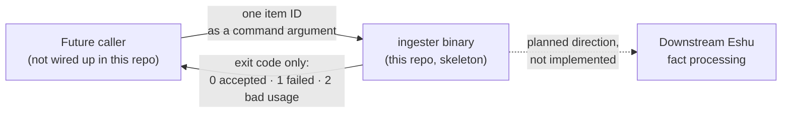
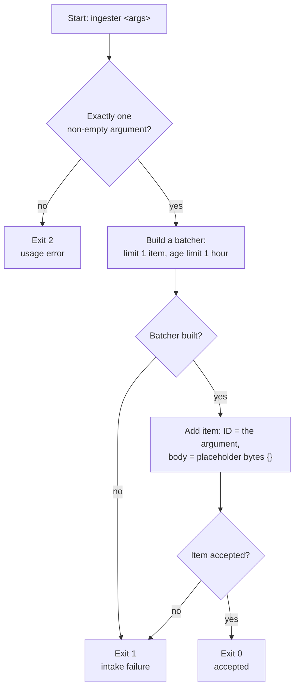
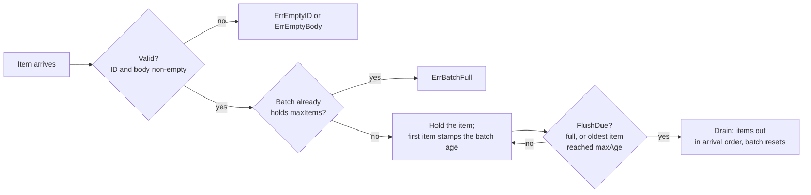

# Diagrams

Every diagram for eshu-ingester lives on this page. Other pages link
here instead of embedding their own copies. The repo
[README](../../README.md) keeps the first diagram only.

## Where the ingester sits

Today the only interface is "run the binary with one item ID, read the
exit code". The dashed arrow is why the repo exists. It isn't
behaviour you can use yet.

Text version: A future caller (not wired up) passes one item ID as a
command argument to the ingester binary. The binary replies with an
exit code only: 0 accepted, 1 failed, 2 bad usage. The dashed arrow to
downstream Eshu fact processing is planned direction, not implemented.

## One run, start to finish

A run checks its arguments, builds a one-item batcher, adds the
argument as an item, and exits. Nothing else happens.

Text version: Start → exactly one non-empty argument? No → exit 2.
Yes → build a batcher (limit 1 item, age limit 1 hour). Build failed →
exit 1. Otherwise add the item (ID = argument, body = `{}`). Add
failed → exit 1. Accepted → exit 0.

## How the batcher decides to flush

An item only joins the batch after it validates, and only if there's
room. The batch is due when full or when its oldest item reaches the
age limit.

Text version: Item arrives → valid (ID and body non-empty)? No →
`ErrEmptyID`/`ErrEmptyBody`. Yes → batch already holds `maxItems`? Yes
→ `ErrBatchFull`. No → hold the item (first item stamps the batch age)
→ `FlushDue` (full, or oldest item reached `maxAge`)? Yes → `Drain`
returns items in arrival order and resets. No → keep holding.
